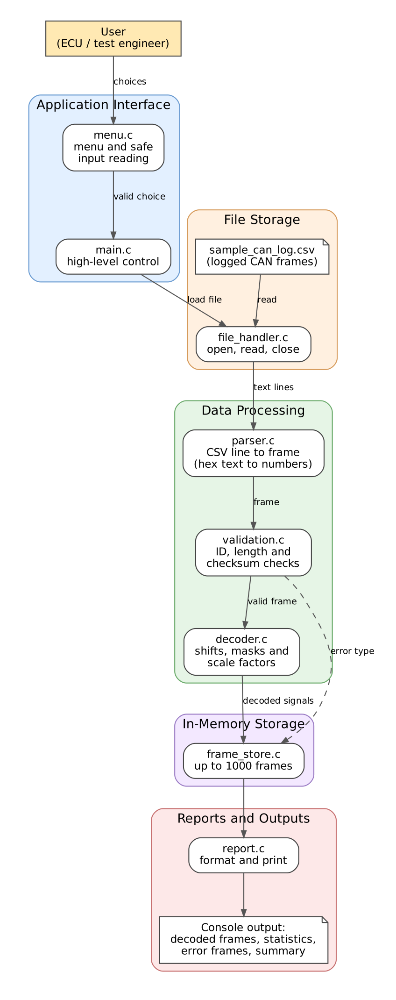

# CAN Log Decoder

**Engineering domain:** Automotive Embedded Systems (In-Vehicle Networks)

A console application written in C that reads a log of recorded CAN frames,
validates every frame, decodes the signals it carries into physical values
(rpm, deg C, km/h, V) and reports errors and statistics.

GitHub repository: <https://github.com/patankarnikhil783-svg/CAN_Log_Decoder>

---

## 1. Problem Statement

In an ECU development and vehicle test laboratory, software and validation
engineers need to interpret recorded CAN frames. They currently decode the
hexadecimal data by hand in text editors and spreadsheets. This is slow, causes
decoding mistakes, hides corrupted frames and gives no consistent summary of the
traffic.

## 2. Proposed Solution

The CAN Log Decoder loads a CSV log file, parses each line, validates the
identifier, data length and checksum of each frame, and decodes the signals of
three known messages using bit shifts, masks and scale factors. Malformed lines
are rejected with their line number and the reason. The user explores the result
through a console menu: decoded frames, per-identifier statistics, frames of one
identifier, error frames and a summary report. It is a software tool only and
does not connect to CAN hardware.

## 3. Features

- Load a CSV log file of CAN frames
- Parse hexadecimal text into numbers; reject malformed lines with line number and reason
- Validate each frame: known identifier, data length of 8, XOR checksum
- Decode three messages (engine data, vehicle speed, battery status)
- Store up to 1000 processed frames in memory
- Menu: load, decode, statistics, frames by identifier, error frames, decode a single frame
- Validation of all user input (menu choices, file names, identifiers, bytes)
- Summary report of lines read, frames decoded and errors found

## 4. Functional Requirements Summary

| ID | Summary |
|---|---|
| FR-01 | Load frames from a CSV file; clear error if the file is missing, unreadable or has no header |
| FR-02, FR-03 | Parse a line into a frame; reject malformed lines with line number and reason |
| FR-04 to FR-06 | Validate identifier, data length (8) and checksum (byte 7 = XOR of bytes 0 to 6) |
| FR-07 to FR-09 | Decode engine data (0x100), vehicle speed (0x200) and battery status (0x300) |
| FR-10 | Store up to 1000 frames and report when full |
| FR-11, FR-12 | Menu loop with validated input |
| FR-13 to FR-18 | Display frames, statistics, frames by identifier, error frames, a single frame and the summary |

The full list, with priorities and verification methods, is in
[`docs/project_proposal.md`](docs/project_proposal.md).

## 5. Software Architecture

```
User -> Console menu (main.c, menu.c)
          |
          +-> File handler -> CSV log file (data/sample_can_log.csv)
          |
          +-> Parser -> Validation -> Decoder -> Frame store
          |
          +-> Report -> Decoded frames, statistics, error frames, summary
```

`main.c` only controls the high-level flow. The logic modules (parser,
validation, decoder, frame store) do no file or console input and output, so
they can be unit tested.



Further diagrams: [module dependencies](docs/module_dependencies.png),
[main flowchart](docs/flow_main.png), [decode flowchart](docs/flow_decode.png).

## 6. Module Descriptions

| Module | Files | Responsibility |
|---|---|---|
| Main application | `src/main.c` | Starts the program, shows the menu, calls the selected action, ends the program |
| Menu | `src/menu.c`, `include/menu.h` | Displays the menu; reads and validates menu choices, file names, identifiers and entered bytes |
| File handler | `src/file_handler.c`, `include/file_handler.h` | The only module that opens, reads and closes log files; reads one bounded line at a time |
| Parser | `src/parser.c`, `include/parser.h` | Converts text into numbers and one CSV line into a frame |
| Validation | `src/validation.c`, `include/validation.h` | Checks identifier, data length and checksum |
| Decoder | `src/decoder.c`, `include/decoder.h` | Holds the signal table; extracts bit fields; converts raw values to physical values |
| Frame store | `src/frame_store.c`, `include/frame_store.h` | Keeps up to 1000 processed frames; statistics and filtering by identifier or error |
| Report | `src/report.c`, `include/report.h` | Formats and prints frames, statistics, error frames and the summary |
| Shared types | `include/types.h` | Constants, enumerations, status codes and structures used by all modules |

## 7. Signal Table

Signals are unsigned and little-endian. `physical value = raw value * factor + offset`.

| Message | ID | Signal | Unit | Start bit | Length | Factor | Offset |
|---|---|---|---|---|---|---|---|
| EngineData | 0x100 | engine speed | rpm | 0 | 16 | 0.25 | 0 |
| EngineData | 0x100 | coolant temperature | deg C | 16 | 8 | 1 | -40 |
| EngineData | 0x100 | throttle position | % | 24 | 8 | 0.4 | 0 |
| VehicleSpeed | 0x200 | vehicle speed | km/h | 0 | 16 | 0.01 | 0 |
| VehicleSpeed | 0x200 | brake pressed | - | 16 | 1 | 1 | 0 |
| VehicleSpeed | 0x200 | gear | - | 17 | 3 | 1 | 0 |
| BatteryStatus | 0x300 | battery voltage | V | 0 | 8 | 0.1 | 0 |

Checksum: byte 7 must equal `b0 ^ b1 ^ b2 ^ b3 ^ b4 ^ b5 ^ b6`.

## 8. Folder Structure

```
CAN_Log_Decoder/
|-- src/
|   |-- main.c
|   |-- menu.c
|   |-- file_handler.c
|   |-- parser.c
|   |-- validation.c
|   |-- decoder.c
|   |-- frame_store.c
|   `-- report.c
|
|-- include/
|   |-- types.h
|   |-- menu.h
|   |-- file_handler.h
|   |-- parser.h
|   |-- validation.h
|   |-- decoder.h
|   |-- frame_store.h
|   `-- report.h
|
|-- tests/
|   `-- test_can_log_decoder.cpp
|
|-- data/
|   `-- sample_can_log.csv
|
|-- docs/
|   |-- project_proposal.md
|   |-- detailed_design.md
|   |-- project_report.md
|   |-- architecture.png
|   |-- module_dependencies.png
|   |-- flow_main.png
|   `-- flow_decode.png
|
|-- Makefile
|-- README.md
|-- .gitignore
`-- LICENSE
```

## 9. C Concepts Used

- Bit manipulation (shifts, masks, OR, XOR) in the decoder and checksum
- Fixed-width unsigned types (`stdint.h`)
- Structures and enumerations (`CanFrame_t`, `StoredFrame_t`, `Status_t`, ...)
- Fixed-size arrays; no dynamic memory allocation
- A constant lookup table (array of structures) for the signal definitions
- Pointers and `const` pointers, output parameters
- Functions with status-code return values
- Multiple source and header files with include guards
- File handling (`fopen`, `fgets`, `fclose`) with every call checked
- String-to-number conversion with explicit error detection
- Floating-point scaling of raw values
- Named constants instead of magic numbers

## 10. Coding Standards Followed

- Names: files `snake_case`; functions and variables `camelCase`; types `PascalCase_t`; constants `UPPER_CASE`
- Four-space indentation; no tab characters and no trailing whitespace in any C, header or test file
- Allman brace style: every opening brace on its own line, and braces on every `if`, `else`, `for` and `while`
- Maximum line length of 100 characters; functions of 50 lines or fewer
- Compiled with `-std=c99 -Wall -Wextra -Wpedantic`; the build produces no warnings
- Each function has one responsibility; pointer arguments are checked for `NULL`
- Functions that can fail return a `Status_t`; return values are checked by the caller
- No unsafe input functions (`gets`, unbounded `scanf`, `atoi`), no `malloc`/`free`, no global variables, no `goto`
- Named constants (`MAX_FRAMES`, `DATA_BYTES`, ...) instead of magic numbers

Details: [`docs/detailed_design.md`](docs/detailed_design.md), section 7.

## 11. Prerequisites

Linux (tested on Ubuntu) with:

```bash
sudo apt update
sudo apt install build-essential libgtest-dev
```

This provides `gcc`, `g++`, `make` and Google Test.

## 12. Build, Run and Test

```bash
git clone https://github.com/patankarnikhil783-svg/CAN_Log_Decoder.git
cd CAN_Log_Decoder

make all     # build the application (creates ./can_decoder)
make run     # build if needed and start the application
make test    # build and run the gTest unit tests
make clean   # remove build/ and the executable
```

## 13. Sample Input

`data/sample_can_log.csv`:

```
time_ms,id,dlc,b0,b1,b2,b3,b4,b5,b6,b7
1000,0x100,8,1A,2C,78,80,00,00,00,CE
1010,0x200,8,E8,03,03,00,00,00,00,E8
1020,0x300,8,7B,00,00,00,00,00,00,7B
1100,0x100,8,34,2E,79,90,00,00,00,F3
1110,0x200,8,F4,03,02,00,00,00,00,00
1120,0x7FF,8,00,00,00,00,00,00,00,00
1130,0x100,8,ZZ,2C,78,80,00,00,00,CE
1200,0x100,8,34,2E,7A,90,00,00,00,F0
```

The file contains valid frames and three deliberate faults: a wrong checksum
(line 6), an unknown identifier (line 7) and an invalid byte (line 8). Line
numbers count the header as line 1.

## 14. Sample Output

Run `make run`, then choose `1` (load), enter `data/sample_can_log.csv`, then
choose `2` (decode):

```
Line 2 | time=1000 ms | ID=0x100 | DLC=8
  engine speed           = 2822.500 rpm
  coolant temperature    = 80.000 deg C
  throttle position      = 51.200 %
Line 3 | time=1010 ms | ID=0x200 | DLC=8
  vehicle speed          = 10.000 km/h
  brake pressed          = 1.000
  gear                   = 1.000
Line 4 | time=1020 ms | ID=0x300 | DLC=8
  battery voltage        = 12.300 V
Line 5 | time=1100 ms | ID=0x100 | DLC=8
  engine speed           = 2957.000 rpm
  coolant temperature    = 81.000 deg C
  throttle position      = 57.600 %
Line 6 | time=1110 ms | ID=0x200 | DLC=8
  ERROR: Checksum mismatch (expected F5, received 00)
Line 7 | time=1120 ms | ID=0x7FF | DLC=8
  ERROR: Unknown identifier
Line 8 rejected: Invalid number
Line 9 | time=1200 ms | ID=0x100 | DLC=8
  engine speed           = 2957.000 rpm
  coolant temperature    = 82.000 deg C
  throttle position      = 57.600 %

========== DECODE SUMMARY ==========
Lines read:          8
Lines rejected:      1
Frames decoded:      5
Unknown ID errors:   1
Length errors:       0
Checksum errors:     1
```

Menu option `3` (statistics):

```
Identifier statistics
ID 0x100: received=3, valid=3, errors=0
ID 0x200: received=2, valid=1, errors=1
ID 0x300: received=1, valid=1, errors=0
Unknown identifiers: 1
```

## 15. Unit-Testing Summary

`make test` builds and runs 30 Google Test cases in `tests/test_can_log_decoder.cpp`.
The expected result is:

```
[==========] 30 tests from 10 test suites ran.
[  PASSED  ] 30 tests.
```

| Area | Functions tested |
|---|---|
| Parsing | `parseHexValue`, `parseFrameLine` |
| Validation | `calculateChecksum`, `validateFrame` |
| Decoding | `extractBits`, `convertRawValue`, `decodeFrame` |
| Frame store | `addFrame`, `getFrame`, `computeIdStatistics`, `findFramesById`, `findErrorFrames` |
| Menu and status | `parseMenuChoice`, `statusToText` |

The tests include positive, negative and boundary cases (for example the maximum
byte value 0xFF and 0x100, the last valid bit position, and a full frame store).
Each test is independent and creates no files. Test cases are mapped to
requirements in [`docs/detailed_design.md`](docs/detailed_design.md), sections 9 and 11.

## 16. Error-Handling Summary

Every function that can fail returns a `Status_t`, and callers check it. Invalid
input never crashes the program; the user sees a message and is asked again (up
to 3 attempts) or returns to the menu.

| Condition | Status | Behaviour |
|---|---|---|
| NULL pointer argument | `STATUS_ERR_NULL_POINTER` | Function returns without side effects |
| File cannot be opened | `STATUS_ERR_FILE_OPEN` | "Cannot open the file"; no file loaded |
| File has no header line | `STATUS_ERR_FILE_EMPTY` | "The file has no header line" |
| File read fails | `STATUS_ERR_FILE_READ` | "Error while reading the file" |
| Line longer than the buffer | `STATUS_ERR_LINE_TOO_LONG` | Line rejected; following lines still processed |
| Wrong number of fields | `STATUS_ERR_FIELD_COUNT` | Line rejected with its line number |
| Value not hexadecimal | `STATUS_ERR_INVALID_HEX` | Line rejected with its line number |
| Value out of range | `STATUS_ERR_OUT_OF_RANGE` | Line rejected with its line number |
| Unknown identifier | `STATUS_ERR_UNKNOWN_ID` | Frame stored as an error and counted |
| Data length not 8 | `STATUS_ERR_BAD_LENGTH` | Frame stored as an error and counted |
| Checksum mismatch | `STATUS_ERR_BAD_CHECKSUM` | Frame stored as an error; expected and received values shown |
| Frame store full (1000) | `STATUS_ERR_STORE_FULL` | Message shown; summary of processed frames displayed |

## 17. Student Information

| Field | Details |
|---|---|
| Student name | Nikhil Shripad Patankar |
| Roll number | 612509029 |
| Division / batch | Instrumentation and Control Engineering |
| Project | CAN Log Decoder in C (individual project) |

## 18. Known Limitations

1. Only three fixed messages (0x100, 0x200, 0x300) are supported; the signal layout is compiled in.
2. Only standard 11-bit identifiers and 8-byte frames are accepted.
3. Signals are unsigned and little-endian only.
4. At most 1000 frames are kept in memory; later lines are not processed.
5. The checksum (XOR of bytes 0 to 6) is defined for this project and is not a real CAN mechanism.
6. Time stamps are assumed to increase but this is not checked.

## 19. Future Enhancements

1. Read signal definitions from a DBC file instead of a compiled-in table.
2. Support signed and big-endian signals and extended 29-bit identifiers.
3. Export the decoded signals to a CSV file for plotting.
4. Process logs of any size without the 1000-frame limit.

## 20. Licence

See [`LICENSE`](LICENSE).
