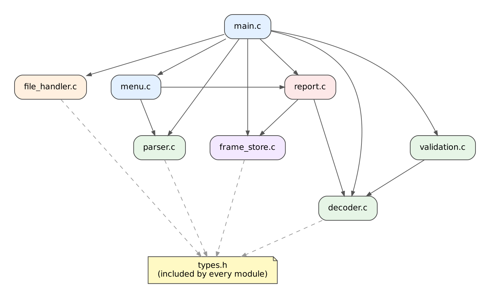

# Detailed Design: CAN Log Decoder

## Document Overview

This document turns the requirements in `project_proposal.md` into a detailed
design. The code, tests and Makefile shall be written against it.

| Section | Content |
|---|---|
| 1 | Data design: constants, enumerations, structures, signal table, data dictionary |
| 2 | Module design |
| 3 | Function design |
| 4 | Input-validation plan |
| 5 | File-handling design |
| 6 | Error-handling strategy |
| 7 | Coding standards plan |
| 8 | Application flow |
| 9 | Unit-test plan |
| 10 | Makefile design |
| 11 | Requirement traceability |

The data design comes first because every other section refers to its types.

**Naming conventions used throughout.** Functions use camelCase (`validateFrame`),
types end in `_t` (`CanFrame_t`), constants and macros use UPPER_CASE
(`MAX_FRAMES`) and file names use snake_case (`file_handler.c`).

---

## 1. Data Design

### 1.1 Constants

| Constant | Value | Purpose |
|---|---|---|
| `MAX_FRAMES` | 1000 | Maximum number of frames kept in memory |
| `DATA_BYTES` | 8 | Number of data bytes in every frame |
| `FIELDS_PER_LINE` | 11 | Fields in a CSV data line: time, identifier, length and 8 data bytes |
| `CHECKSUM_INDEX` | 7 | Index of the checksum byte in the data bytes |
| `MAX_CAN_ID` | 0x7FF | Largest 11-bit identifier |
| `MESSAGE_COUNT` | 3 | Number of known messages |
| `MAX_SIGNALS_PER_MESSAGE` | 3 | Largest number of signals in one message |
| `MAX_LINE_LENGTH` | 256 | Size of the buffer that holds one line of text |
| `MAX_FILE_NAME_LENGTH` | 128 | Size of the buffer that holds a file name |
| `ID_ENGINE_DATA` | 0x100 | Identifier of the engine data message |
| `ID_VEHICLE_SPEED` | 0x200 | Identifier of the vehicle speed message |
| `ID_BATTERY_STATUS` | 0x300 | Identifier of the battery status message |

### 1.2 Enumeration Definitions

#### Enumeration: Status_t

**Purpose:** one result type for every function that can fail. It is also stored
with each frame, where it records the first check the frame failed.

```c
typedef enum
{
    STATUS_SUCCESS = 0,
    STATUS_END_OF_FILE,
    STATUS_ERR_NULL_POINTER,
    STATUS_ERR_INVALID_ARGUMENT,
    STATUS_ERR_FILE_OPEN,
    STATUS_ERR_FILE_EMPTY,
    STATUS_ERR_LINE_TOO_LONG,
    STATUS_ERR_FIELD_COUNT,
    STATUS_ERR_INVALID_HEX,
    STATUS_ERR_OUT_OF_RANGE,
    STATUS_ERR_STORE_FULL,
    STATUS_ERR_UNKNOWN_ID,
    STATUS_ERR_BAD_LENGTH,
    STATUS_ERR_BAD_CHECKSUM
} Status_t;
```

| Constant | Meaning |
|---|---|
| `STATUS_SUCCESS` | The operation succeeded, or the frame passed every check |
| `STATUS_END_OF_FILE` | No more lines to read. This is not an error |
| `STATUS_ERR_NULL_POINTER` | A required pointer argument was NULL |
| `STATUS_ERR_INVALID_ARGUMENT` | An argument had an unacceptable value, for example an empty file name |
| `STATUS_ERR_FILE_OPEN` | The file does not exist or cannot be opened |
| `STATUS_ERR_FILE_EMPTY` | The file has no header line |
| `STATUS_ERR_LINE_TOO_LONG` | A line is longer than `MAX_LINE_LENGTH` |
| `STATUS_ERR_FIELD_COUNT` | A line does not have exactly `FIELDS_PER_LINE` fields |
| `STATUS_ERR_INVALID_HEX` | A field is empty or is not valid hexadecimal or decimal text |
| `STATUS_ERR_OUT_OF_RANGE` | A number is outside its allowed range |
| `STATUS_ERR_STORE_FULL` | The frame store already holds `MAX_FRAMES` frames |
| `STATUS_ERR_UNKNOWN_ID` | The identifier is not in the table of known messages |
| `STATUS_ERR_BAD_LENGTH` | The data length is not 8 |
| `STATUS_ERR_BAD_CHECKSUM` | Byte 7 does not equal the XOR of bytes 0 to 6 |

#### Enumeration: MenuChoice_t

**Purpose:** gives the menu options readable names.

```c
typedef enum
{
    MENU_EXIT = 0,
    MENU_LOAD_FILE,
    MENU_DECODE,
    MENU_STATISTICS,
    MENU_FRAMES_BY_ID,
    MENU_ERROR_FRAMES,
    MENU_SINGLE_FRAME,
    MENU_INVALID
} MenuChoice_t;
```

| Constant | Value | Meaning |
|---|---|---|
| `MENU_EXIT` | 0 | End the program |
| `MENU_LOAD_FILE` | 1 | Ask for a file name and check that the file can be read |
| `MENU_DECODE` | 2 | Process every line of the loaded file |
| `MENU_STATISTICS` | 3 | Show statistics for each identifier |
| `MENU_FRAMES_BY_ID` | 4 | Show the stored frames of one identifier |
| `MENU_ERROR_FRAMES` | 5 | Show the stored frames that failed a check |
| `MENU_SINGLE_FRAME` | 6 | Validate and decode one frame entered by the user |
| `MENU_INVALID` | 7 | Returned when the input is not a valid choice |

### 1.3 Structure Definitions

#### Structure: CanFrame_t

**Purpose:** one CAN frame as read from the log.

```c
typedef struct
{
    uint32_t timeMs;
    uint16_t id;
    uint8_t  dlc;
    uint8_t  data[DATA_BYTES];
} CanFrame_t;
```

| Member | C Type | Valid Range or Size | Description |
|---|---|---|---|
| `timeMs` | `uint32_t` | 0 to 4294967295 | Time stamp in milliseconds |
| `id` | `uint16_t` | 0 to 0x7FF | 11-bit identifier |
| `dlc` | `uint8_t` | 0 to 8 as parsed, 8 for a valid frame | Data length code |
| `data` | `uint8_t[8]` | 0x00 to 0xFF each | Data bytes. `data[7]` is the checksum |

#### Structure: SignalDefinition_t

**Purpose:** describes where one signal sits inside the data bytes and how to
convert its raw value into a physical value.

```c
typedef struct
{
    const char *name;
    const char *unit;
    uint8_t     startBit;
    uint8_t     bitLength;
    float       factor;
    float       offset;
} SignalDefinition_t;
```

| Member | C Type | Valid Range or Size | Description |
|---|---|---|---|
| `name` | `const char *` | Non-NULL text | Signal name |
| `unit` | `const char *` | Non-NULL text | Unit, or an empty string |
| `startBit` | `uint8_t` | 0 to 63 | Position of the signal's lowest bit (bit 0 is the lowest bit of `data[0]`) |
| `bitLength` | `uint8_t` | 1 to 16 | Number of bits in the signal |
| `factor` | `float` | Non-zero | Multiplier applied to the raw value |
| `offset` | `float` | Any | Value added after multiplying |

#### Structure: MessageDefinition_t

**Purpose:** describes one known message and its signals.

```c
typedef struct
{
    uint16_t           id;
    const char        *name;
    uint8_t            signalCount;
    SignalDefinition_t signals[MAX_SIGNALS_PER_MESSAGE];
} MessageDefinition_t;
```

| Member | C Type | Valid Range or Size | Description |
|---|---|---|---|
| `id` | `uint16_t` | 0 to 0x7FF | Identifier of the message |
| `name` | `const char *` | Non-NULL text | Message name |
| `signalCount` | `uint8_t` | 1 to 3 | Number of signals used in the array |
| `signals` | `SignalDefinition_t[3]` | See `signalCount` | The signals of the message |

#### Structure: DecodedValues_t

**Purpose:** the physical values obtained from one frame.

```c
typedef struct
{
    uint8_t count;
    float   values[MAX_SIGNALS_PER_MESSAGE];
} DecodedValues_t;
```

| Member | C Type | Valid Range or Size | Description |
|---|---|---|---|
| `count` | `uint8_t` | 0 to 3 | Number of valid values. It is 0 for a frame that was not decoded |
| `values` | `float[3]` | Any | Decoded values, in the order of the signal table |

#### Structure: StoredFrame_t

**Purpose:** one processed frame kept in memory.

```c
typedef struct
{
    CanFrame_t      frame;
    uint32_t        lineNumber;
    Status_t        status;
    DecodedValues_t decoded;
} StoredFrame_t;
```

| Member | C Type | Valid Range or Size | Description |
|---|---|---|---|
| `frame` | `CanFrame_t` | See `CanFrame_t` | The frame as read |
| `lineNumber` | `uint32_t` | 2 or more | Line of the log file (the header is line 1) |
| `status` | `Status_t` | `STATUS_SUCCESS` or the first failed check | Result of validation |
| `decoded` | `DecodedValues_t` | See `DecodedValues_t` | Decoded values, present only if the frame is valid |

#### Structure: FrameStore_t

**Purpose:** the fixed-size store of up to 1000 processed frames.

```c
typedef struct
{
    StoredFrame_t items[MAX_FRAMES];
    uint16_t      count;
} FrameStore_t;
```

| Member | C Type | Valid Range or Size | Description |
|---|---|---|---|
| `items` | `StoredFrame_t[1000]` | Only the first `count` are used | The stored frames in the order read |
| `count` | `uint16_t` | 0 to 1000 | Number of frames stored |

The structure is about 40 KB, which is acceptable as a local variable in
`main`. It is passed to functions by pointer.

#### Structure: IdStatistics_t

**Purpose:** the statistics for one identifier.

```c
typedef struct
{
    uint16_t id;
    uint32_t received;
    uint32_t valid;
    uint32_t errors;
} IdStatistics_t;
```

| Member | C Type | Valid Range or Size | Description |
|---|---|---|---|
| `id` | `uint16_t` | 0 to 0x7FF | The identifier |
| `received` | `uint32_t` | 0 to 1000 | Stored frames with this identifier |
| `valid` | `uint32_t` | 0 to `received` | Frames that passed every check |
| `errors` | `uint32_t` | 0 to `received` | Frames that failed a check |

#### Structure: Summary_t

**Purpose:** the counters for the summary report.

```c
typedef struct
{
    uint32_t linesRead;
    uint32_t linesRejected;
    uint32_t framesDecoded;
    uint32_t unknownIdErrors;
    uint32_t lengthErrors;
    uint32_t checksumErrors;
} Summary_t;
```

| Member | C Type | Valid Range or Size | Description |
|---|---|---|---|
| `linesRead` | `uint32_t` | 0 or more | Data lines read (the header is not counted) |
| `linesRejected` | `uint32_t` | 0 to `linesRead` | Lines that could not be parsed |
| `framesDecoded` | `uint32_t` | 0 to `linesRead` | Frames that passed every check and were decoded |
| `unknownIdErrors` | `uint32_t` | 0 or more | Frames with an unknown identifier |
| `lengthErrors` | `uint32_t` | 0 or more | Frames whose data length is not 8 |
| `checksumErrors` | `uint32_t` | 0 or more | Frames with a wrong checksum |

### 1.4 Signal Table

The decoder holds this table as a constant array of `MessageDefinition_t`.
Identifiers, positions and conversions are changed here only (NFR-07).

**Bit numbering.** Signals are unsigned and little-endian. Bit 0 is the lowest
bit of `data[0]`, bit 8 is the lowest bit of `data[1]`, and so on. The raw value
of a signal is taken from `bitLength` bits starting at `startBit`, and

```
physical value = raw value * factor + offset
```

| Message | ID | Signal | Unit | Start bit | Length | Factor | Offset | Meaning |
|---|---|---|---|---|---|---|---|---|
| EngineData | 0x100 | engine speed | rpm | 0 | 16 | 0.25 | 0 | Bytes 0 and 1 |
| EngineData | 0x100 | coolant temperature | deg C | 16 | 8 | 1 | -40 | Byte 2 |
| EngineData | 0x100 | throttle position | % | 24 | 8 | 0.4 | 0 | Byte 3 |
| VehicleSpeed | 0x200 | vehicle speed | km/h | 0 | 16 | 0.01 | 0 | Bytes 0 and 1 |
| VehicleSpeed | 0x200 | brake pressed | none | 16 | 1 | 1 | 0 | Bit 0 of byte 2, 1 means ON |
| VehicleSpeed | 0x200 | gear | none | 17 | 3 | 1 | 0 | Bits 1 to 3 of byte 2 |
| BatteryStatus | 0x300 | battery voltage | V | 0 | 8 | 0.1 | 0 | Byte 0 |

**Worked example.** `1A 2C 78 80 00 00 00 CE` on identifier 0x100:

| Signal | Raw value | Physical value |
|---|---|---|
| engine speed | `0x2C1A` = 11290 | 11290 x 0.25 = 2822.5 rpm |
| coolant temperature | `0x78` = 120 | 120 - 40 = 80 deg C |
| throttle position | `0x80` = 128 | 128 x 0.4 = 51.2 % |
| checksum | 0x1A ^ 0x2C ^ 0x78 ^ 0x80 ^ 0 ^ 0 ^ 0 = 0xCE | equals byte 7, so the frame is valid |

### 1.5 Data Dictionary

| Data Item | C Type | Valid Range or Size | Validation Rule | Description |
|---|---|---|---|---|
| time stamp | `uint32_t` | 0 to 4294967295 | Decimal digits only, no sign | Time of the frame in milliseconds |
| identifier | `uint16_t` | 0 to 0x7FF | Hexadecimal text with an optional `0x` prefix. Above 0x7FF is out of range. Must be one of 0x100, 0x200 or 0x300 to be decoded | Message identifier |
| data length | `uint8_t` | 0 to 8 | Decimal digits only. Above 8 is out of range. Must equal 8 for a valid frame | Data length code |
| data byte | `uint8_t` | 0x00 to 0xFF | One or two hexadecimal digits, no prefix | One of the eight data bytes |
| checksum | `uint8_t` | 0x00 to 0xFF | Must equal the XOR of data bytes 0 to 6 | Data byte 7 |
| line number | `uint32_t` | 2 or more | Counted by the file handler | Position of the line in the file |
| frame status | `Status_t` | Any `Status_t` value | Set by the validation module | Result of the checks on a frame |
| raw value | `uint32_t` | 0 to 65535 | Extracted from `bitLength` bits | Unsigned value of a signal before conversion |
| physical value | `float` | Any finite number | Calculated from the raw value | Signal value in its unit |
| file name | `char[128]` | 1 to 127 characters | Not empty, no newline, and the file can be opened | Name of the log file |
| menu input | `char[16]` | 1 to 15 characters | A whole number from 0 to 6 with nothing else | Text typed at the menu |
| selected identifier | `uint16_t` | 0 to 0x7FF | Hexadecimal text with an optional `0x` prefix | Identifier chosen for filtering |
| line buffer | `char[256]` | Up to 255 characters | Longer lines are rejected | One line of the log file |
| stored frame count | `uint16_t` | 0 to 1000 | A frame is added only while the count is below 1000 | Number of frames in the store |

### 1.6 Design Decisions Recorded Here

1. **A line that cannot be parsed is rejected and not stored.** It is counted in
   `linesRejected` and reported with its line number.
2. **A frame that parses but fails a check is stored.** Its `status` records
   which check failed, so that the error frames can be listed later.
3. **The checks run in a fixed order:** identifier, then data length, then
   checksum. The status of a frame is the first check that failed. The checksum
   is not examined if the length is wrong, because the byte positions are then
   not reliable.
4. **Only frames with the status `STATUS_SUCCESS` are decoded.** For all other
   frames `decoded.count` is 0.
5. **Time stamps are assumed to increase** (section 3.3 of the proposal). The
   program does not check this.
6. **Signals are described by data, not by code.** The decoder uses one generic
   bit-extraction routine and the signal table, so adding a signal means adding
   a table row.

---

## 2. Module Design

### 2.1 Module Summary

| Module Name | Source File | Header File | Responsibility |
|---|---|---|---|
| Main application | main.c | Not applicable | Controls the high-level application flow: runs the menu loop and calls the module that performs each choice |
| Menu | menu.c | menu.h | Displays the menu, reads and validates user input |
| File handler | file_handler.c | file_handler.h | The only module that opens, reads and closes files |
| Parser | parser.c | parser.h | Converts text to numbers and one CSV line into a frame |
| Validation | validation.c | validation.h | Checks the identifier, the data length and the checksum of a frame |
| Decoder | decoder.c | decoder.h | Owns the signal table, extracts bit fields and converts raw values into physical values |
| Frame store | frame_store.c | frame_store.h | Keeps processed frames in memory and finds frames by identifier or by error |
| Report | report.c | report.h | Prints decoded frames, statistics, frame lists and the summary |
| Shared types | Not applicable | types.h | Declares the shared constants, enumerations and structures (see section 1) |

### 2.2 Module Dependencies



An arrow means "uses functions of". The rules that the design follows are:

1. **No circular dependencies.** The arrows only point downwards.
2. **Only `file_handler.c` opens, reads or closes files.**
3. **Only `menu.c` reads from the keyboard.** It also prints the menu and the
   prompts. `report.c` prints all results.
4. **`parser.c`, `validation.c`, `decoder.c` and `frame_store.c` perform no
   input or output**, so they can be unit tested directly.
5. **`main.c` contains no parsing, validation or decoding logic.** It only
   calls the other modules.
6. Every module includes `types.h`.

### 2.3 Detailed Module Description

#### Module: Main application

**Source file:** `main.c`

**Header file:** Not applicable

**Purpose:** starts the program and controls the flow from start to exit.

**Responsibilities:**
- Create the frame store, the summary counters and the file name buffer.
- Repeat: ask the menu for a choice and call the matching handler function.
- Handle each choice in a short `static` function that only calls other
  modules: `handleLoadFile`, `handleDecode`, `handleStatistics`,
  `handleFramesById`, `handleErrorFrames` and `handleSingleFrame`.
- Refuse an action that needs data when no file is loaded or no frames are
  stored, and tell the user what to do first.
- Print the text of any error returned by a module.

**Public functions:**
- `int main(void)`

**Data used or owned:** the `FrameStore_t`, the `Summary_t`, the file name
buffer and a flag that records whether a file has been loaded.

**Dependencies:** `menu`, `file_handler`, `parser`, `validation`, `decoder`,
`frame_store`, `report`.

**Possible errors:** any `Status_t` value returned by a module, reported to the
user with `statusToText`. No file loaded and empty store are handled by `main.c`
itself with a message.

#### Module: Menu

**Source file:** `menu.c`

**Header file:** `menu.h`

**Purpose:** all keyboard interaction.

**Responsibilities:**
- Print the menu and read one line of input with `fgets` into a bounded buffer.
- Convert the text into a menu choice and reject anything that is not a whole
  number from 0 to 6.
- Read and validate a file name, a hexadecimal identifier and the data of one
  frame (identifier, length and eight bytes).
- Discard the rest of an over-long input line.
- Treat the end of input (for example Ctrl+D) as the exit choice, so the menu
  loop can never repeat forever.

**Public functions:**
- `MenuChoice_t parseMenuChoice(const char *text)`
- `MenuChoice_t readMenuChoice(void)`
- `Status_t readFileName(char *buffer, size_t size)`
- `Status_t readIdentifier(uint16_t *id)`
- `Status_t readFrameFromUser(CanFrame_t *frame)`

**Data used or owned:** a local input line buffer. `parseMenuChoice` is a pure
function with no input or output, so it is unit tested.

**Dependencies:** `parser` (number conversion), `report` (`statusToText`),
`types`.

**Possible errors:** `STATUS_ERR_NULL_POINTER`, `STATUS_ERR_INVALID_ARGUMENT`
(empty input), `STATUS_ERR_LINE_TOO_LONG`, `STATUS_ERR_INVALID_HEX`,
`STATUS_ERR_OUT_OF_RANGE`, `STATUS_END_OF_FILE` (input closed).

#### Module: File handler

**Source file:** `file_handler.c`

**Header file:** `file_handler.h`

**Purpose:** the only place where files are opened, read and closed.

**Responsibilities:**
- Open the log file and check that it has a header line, which it consumes.
- Read one line at a time into a bounded buffer and remove the line ending.
- Report an over-long line and skip the rest of it.
- Close the file safely, also when the pointer is NULL.

**Public functions:**
- `Status_t openLogFile(const char *fileName, FILE **file)`
- `Status_t readLogLine(FILE *file, char *buffer, size_t size)`
- `void closeLogFile(FILE *file)`

**Data used or owned:** none. The `FILE` pointer belongs to the caller.

**Dependencies:** `types`.

**Possible errors:** `STATUS_ERR_NULL_POINTER`, `STATUS_ERR_INVALID_ARGUMENT`,
`STATUS_ERR_FILE_OPEN`, `STATUS_ERR_FILE_EMPTY`, `STATUS_ERR_LINE_TOO_LONG`,
`STATUS_END_OF_FILE`.

#### Module: Parser

**Source file:** `parser.c`

**Header file:** `parser.h`

**Purpose:** turns text into numbers and a CSV line into a frame.

**Responsibilities:**
- Convert decimal text and hexadecimal text (with an optional `0x` prefix) to an
  unsigned number, rejecting empty text, stray characters, a sign and values
  above a given maximum.
- Split a data line into exactly 11 fields and fill a frame.
- Recognise a blank line.

**Public functions:**
- `Status_t parseDecimalValue(const char *text, uint32_t maxValue, uint32_t *value)`
- `Status_t parseHexValue(const char *text, uint32_t maxValue, uint32_t *value)`
- `Status_t parseFrameLine(const char *line, CanFrame_t *frame)`
- `int isBlankLine(const char *line)`

**Data used or owned:** none. No input or output.

**Dependencies:** `types`.

**Possible errors:** `STATUS_ERR_NULL_POINTER`, `STATUS_ERR_FIELD_COUNT`,
`STATUS_ERR_INVALID_HEX`, `STATUS_ERR_OUT_OF_RANGE`.

#### Module: Validation

**Source file:** `validation.c`

**Header file:** `validation.h`

**Purpose:** decides whether a parsed frame is acceptable.

**Responsibilities:**
- Calculate the checksum, which is the XOR of data bytes 0 to 6.
- Check a frame in a fixed order: known identifier, then data length of 8, then
  checksum. Return the first check that fails.

**Public functions:**
- `Status_t calculateChecksum(const uint8_t *data, uint8_t *checksum)`
- `Status_t validateFrame(const CanFrame_t *frame)`

**Data used or owned:** none. No input or output.

**Dependencies:** `decoder` (`findMessageDefinition`, to ask whether an identifier
is known), `types`.

**Possible errors:** `STATUS_ERR_NULL_POINTER`, `STATUS_ERR_UNKNOWN_ID`,
`STATUS_ERR_BAD_LENGTH`, `STATUS_ERR_BAD_CHECKSUM`.

#### Module: Decoder

**Source file:** `decoder.c`

**Header file:** `decoder.h`

**Purpose:** turns the data bytes of a valid frame into physical values.

**Responsibilities:**
- Own the constant table of known messages and signals (section 1.4).
- Look up the definition of a message by identifier.
- Extract a field of 1 to 32 bits from the data bytes with shifts and masks.
- Apply the factor and the offset to a raw value.
- Decode every signal of a frame.

**Public functions:**
- `const MessageDefinition_t *findMessageDefinition(uint16_t id)`
- `Status_t extractBits(const uint8_t *data, uint8_t startBit, uint8_t bitLength, uint32_t *raw)`
- `float convertRawValue(uint32_t raw, float factor, float offset)`
- `Status_t decodeFrame(const CanFrame_t *frame, DecodedValues_t *decoded)`

**Data used or owned:** the constant signal table (an array of
`MessageDefinition_t`), which is the only place that holds identifiers, bit
positions, factors and offsets.

**Dependencies:** `types`.

**Possible errors:** `STATUS_ERR_NULL_POINTER`, `STATUS_ERR_INVALID_ARGUMENT`
(bit field outside the 64 data bits), `STATUS_ERR_UNKNOWN_ID`.

#### Module: Frame store

**Source file:** `frame_store.c`

**Header file:** `frame_store.h`

**Purpose:** keeps the processed frames and answers questions about them.

**Responsibilities:**
- Start with an empty store and add frames until it holds 1000.
- Return a stored frame by index, and the number of frames stored.
- Calculate the statistics of one identifier: frames received, valid and in
  error. The statistics report uses it for each known identifier, and counts
  the frames with an unknown identifier separately.
- Find the indices of all frames with a given identifier.
- Find the indices of all frames that failed a check.

**Public functions:**
- `Status_t initFrameStore(FrameStore_t *store)`
- `Status_t addFrame(FrameStore_t *store, const StoredFrame_t *item)`
- `const StoredFrame_t *getFrame(const FrameStore_t *store, uint16_t index)`
- `uint16_t getFrameCount(const FrameStore_t *store)`
- `Status_t computeIdStatistics(const FrameStore_t *store, uint16_t id, IdStatistics_t *stats)`
- `Status_t findFramesById(const FrameStore_t *store, uint16_t id, uint16_t *indices, uint16_t maxIndices, uint16_t *count)`
- `Status_t findErrorFrames(const FrameStore_t *store, uint16_t *indices, uint16_t maxIndices, uint16_t *count)`

**Data used or owned:** none. The `FrameStore_t` belongs to the caller and is
passed by pointer. `getFrame` returns NULL for an invalid index.

**Dependencies:** `types`.

**Possible errors:** `STATUS_ERR_NULL_POINTER`, `STATUS_ERR_INVALID_ARGUMENT`,
`STATUS_ERR_STORE_FULL`.

#### Module: Report

**Source file:** `report.c`

**Header file:** `report.h`

**Purpose:** all output of results.

**Responsibilities:**
- Print a processed frame: the decoded signals with their names and units, or
  the error found.
- Print a rejected line with its line number and the reason.
- Print a list of stored frames chosen by index.
- Print the statistics for each known identifier and the count of unknown
  identifiers.
- Print the summary report.
- Convert a `Status_t` into readable text.
- Write to the stream it is given, so output can be redirected.

**Public functions:**
- `const char *statusToText(Status_t status)`
- `void printFrameResult(FILE *out, const StoredFrame_t *item)`
- `void printRejectedLine(FILE *out, uint32_t lineNumber, Status_t status)`
- `void printFrameList(FILE *out, const FrameStore_t *store, const uint16_t *indices, uint16_t count)`
- `void printStatistics(FILE *out, const FrameStore_t *store)`
- `void printSummary(FILE *out, const Summary_t *summary)`

**Data used or owned:** none.

**Dependencies:** `frame_store` (statistics), `decoder` (signal names and units),
`types`.

**Possible errors:** a NULL pointer argument produces no output. `statusToText`
returns `"Unknown status"` for a value it does not know.

#### Module: Shared types

**Header file:** `types.h`

**Purpose:** the constants, enumerations and structures shared by all modules,
as defined in section 1. It contains no executable code.

### 2.4 Design Notes

1. **Public headers were checked.** All function prototypes in this section were
   compiled as C99 and as C++17 with every warning enabled, so the C code and
   the C++ gTest files can use them.
2. **Why `main.c` has handler functions.** Each is a few lines that call other
   modules. This keeps the menu loop readable while `main.c` contains no
   decoding logic.
3. **Statistics.** FR-14 asks for statistics for each identifier. The design
   reports the three known identifiers and one line for all frames with an
   unknown identifier, so the number of lines is fixed.

---

## 3. Function Design

This section specifies every important function. Each specification gives the
prototype, the parameters, the return values, the conditions before and after the
call, the errors handled, the related requirements and the planned unit tests
(`UT-xx`, listed in section 9). The remaining public functions are summarised in
section 3.13.

**Conventions.** A function that can fail returns `Status_t` and passes its
result through an output parameter. A function never writes to its output
parameter when it returns an error, unless stated. Every pointer parameter is
checked for NULL before it is used.

### 3.1 Function: parseHexValue

**Module:** Parser

**Prototype:**
```c
Status_t parseHexValue(const char *text, uint32_t maxValue, uint32_t *value);
```

**Purpose:** converts hexadecimal text, with an optional `0x` or `0X` prefix, into
an unsigned number.

**Parameters:**

| Parameter | C Type | Direction | Description | Valid Values |
|---|---|---|---|---|
| `text` | `const char *` | Input | Text to convert | Non-NULL, NUL-terminated |
| `maxValue` | `uint32_t` | Input | Largest accepted value | Any |
| `value` | `uint32_t *` | Output | The converted number | Non-NULL |

**Return type:** `Status_t`

**Return values:**

| Return Value | Meaning |
|---|---|
| `STATUS_SUCCESS` | The text was converted and `*value` is set |
| `STATUS_ERR_NULL_POINTER` | `text` or `value` is NULL |
| `STATUS_ERR_INVALID_HEX` | The text is empty, has only a prefix, or contains a character that is not a hexadecimal digit (including spaces and signs) |
| `STATUS_ERR_OUT_OF_RANGE` | The number is larger than `maxValue` or does not fit in 32 bits |

**Preconditions:**
- `text` points to a NUL-terminated string.
- `value` points to a writable `uint32_t`.

**Postconditions:**
- `*value` is changed only when `STATUS_SUCCESS` is returned.
- `text` is not modified.

**Errors handled:** NULL pointers, empty text, non-hexadecimal characters,
values above the maximum.

**Related requirements:** FR-02, FR-03, FR-12

**Planned unit tests:** UT-01, UT-02, UT-03, UT-04, UT-05, UT-06, UT-07

### 3.2 Function: parseFrameLine

**Module:** Parser

**Prototype:**
```c
Status_t parseFrameLine(const char *line, CanFrame_t *frame);
```

**Purpose:** splits one data line of the log into its 11 comma-separated fields
and fills a frame.

**Field order and rules:**

| Field | Content | Rule |
|---|---|---|
| 1 | time stamp (ms) | Decimal digits, up to 4294967295 |
| 2 | identifier | Hexadecimal, optional `0x` prefix, up to 0x7FF |
| 3 | data length | Decimal digits, up to 8 |
| 4 to 11 | data bytes 0 to 7 | Hexadecimal, up to 0xFF, no prefix |

A trailing carriage return or line feed is ignored. Spaces around fields are not
accepted.

**Parameters:**

| Parameter | C Type | Direction | Description | Valid Values |
|---|---|---|---|---|
| `line` | `const char *` | Input | One line of text | Non-NULL, NUL-terminated |
| `frame` | `CanFrame_t *` | Output | The parsed frame | Non-NULL |

**Return type:** `Status_t`

**Return values:**

| Return Value | Meaning |
|---|---|
| `STATUS_SUCCESS` | The line was parsed and `*frame` is set |
| `STATUS_ERR_NULL_POINTER` | `line` or `frame` is NULL |
| `STATUS_ERR_FIELD_COUNT` | The line does not have exactly 11 fields (this includes a blank line) |
| `STATUS_ERR_INVALID_HEX` | A field is empty or is not a valid number |
| `STATUS_ERR_OUT_OF_RANGE` | The identifier is above 0x7FF, the data length above 8, or a byte above 0xFF |

**Preconditions:**
- `line` is NUL-terminated and shorter than `MAX_LINE_LENGTH`.
- `frame` points to a writable `CanFrame_t`.

**Postconditions:**
- `*frame` is written only when `STATUS_SUCCESS` is returned.
- `line` is not modified.

**Errors handled:** NULL pointers, too few or too many fields, empty fields,
non-numeric text, out-of-range values.

**Related requirements:** FR-02, FR-03

**Planned unit tests:** UT-11, UT-12, UT-13, UT-14, UT-15, UT-16, UT-17, UT-18, UT-19

### 3.3 Function: calculateChecksum

**Module:** Validation

**Prototype:**
```c
Status_t calculateChecksum(const uint8_t *data, uint8_t *checksum);
```

**Purpose:** calculates the checksum of a frame, which is the XOR of data
bytes 0 to 6.

**Parameters:**

| Parameter | C Type | Direction | Description | Valid Values |
|---|---|---|---|---|
| `data` | `const uint8_t *` | Input | The data bytes of a frame | Non-NULL, at least 8 bytes readable (only the first 7 are used) |
| `checksum` | `uint8_t *` | Output | The calculated checksum | Non-NULL |

**Return type:** `Status_t`

**Return values:**

| Return Value | Meaning |
|---|---|
| `STATUS_SUCCESS` | `*checksum` holds the XOR of bytes 0 to 6 |
| `STATUS_ERR_NULL_POINTER` | `data` or `checksum` is NULL |

**Preconditions:** `data` points to an array of `DATA_BYTES` bytes.

**Postconditions:** `*checksum = data[0] ^ data[1] ^ ... ^ data[6]`. Byte 7 is not
read.

**Errors handled:** NULL pointers.

**Related requirements:** FR-06

**Planned unit tests:** UT-21, UT-22, UT-23

### 3.4 Function: validateFrame

**Module:** Validation

**Prototype:**
```c
Status_t validateFrame(const CanFrame_t *frame);
```

**Purpose:** decides whether a parsed frame is acceptable, checking in a fixed
order and returning the first check that fails.

**Algorithm:**
1. If `findMessageDefinition(frame->id)` returns NULL, return `STATUS_ERR_UNKNOWN_ID`.
2. If `frame->dlc` is not `DATA_BYTES`, return `STATUS_ERR_BAD_LENGTH`.
3. Calculate the checksum. If it differs from `frame->data[CHECKSUM_INDEX]`,
   return `STATUS_ERR_BAD_CHECKSUM`.
4. Otherwise return `STATUS_SUCCESS`.

**Parameters:**

| Parameter | C Type | Direction | Description | Valid Values |
|---|---|---|---|---|
| `frame` | `const CanFrame_t *` | Input | The frame to check | Non-NULL |

**Return type:** `Status_t`

**Return values:**

| Return Value | Meaning |
|---|---|
| `STATUS_SUCCESS` | The frame passed every check |
| `STATUS_ERR_NULL_POINTER` | `frame` is NULL |
| `STATUS_ERR_UNKNOWN_ID` | The identifier is not in the signal table |
| `STATUS_ERR_BAD_LENGTH` | The data length is not 8 |
| `STATUS_ERR_BAD_CHECKSUM` | Byte 7 is not the XOR of bytes 0 to 6 |

**Preconditions:** `frame` was filled by `parseFrameLine` or by the menu.

**Postconditions:** the frame is not modified.

**Errors handled:** NULL pointer, unknown identifier, wrong length, wrong
checksum.

**Related requirements:** FR-04, FR-05, FR-06

**Planned unit tests:** UT-24, UT-25, UT-26, UT-27, UT-28, UT-29

### 3.5 Function: extractBits

**Module:** Decoder

**Prototype:**
```c
Status_t extractBits(const uint8_t *data, uint8_t startBit,
                     uint8_t bitLength, uint32_t *raw);
```

**Purpose:** returns the unsigned value of `bitLength` bits that start at
`startBit` in the data bytes. This is the bit-manipulation core of the project.

**Algorithm:**
1. Check the pointers, that `bitLength` is from 1 to 32 and that
   `startBit + bitLength` is at most 64.
2. Build a 64-bit value with `data[0]` as the lowest byte:
   `value = data[0] | (data[1] << 8) | ... | (data[7] << 56)`, using a 64-bit
   unsigned type.
3. Shift the value right by `startBit` so the wanted bits start at bit 0.
4. Keep only the lowest `bitLength` bits with the mask `(1 << bitLength) - 1`.

**Worked examples:**

| Data bytes | Start bit | Length | Steps | Result |
|---|---|---|---|---|
| `1A 2C 78 80 ...` | 0 | 16 | bytes 0 and 1: `0x1A` OR `(0x2C << 8)` | `0x2C1A` = 11290 |
| `1A 2C 78 80 ...` | 16 | 8 | shift right by 16, mask `0xFF` | `0x78` = 120 |
| `E8 03 03 00 ...` | 16 | 1 | shift right by 16 gives `0x03`, mask `0x1` | 1 |
| `E8 03 03 00 ...` | 17 | 3 | shift right by 17 gives `0x01`, mask `0x7` | 1 |

**Parameters:**

| Parameter | C Type | Direction | Description | Valid Values |
|---|---|---|---|---|
| `data` | `const uint8_t *` | Input | The 8 data bytes | Non-NULL |
| `startBit` | `uint8_t` | Input | Position of the lowest bit of the field | 0 to 63 |
| `bitLength` | `uint8_t` | Input | Number of bits in the field | 1 to 32, and `startBit + bitLength <= 64` |
| `raw` | `uint32_t *` | Output | The extracted value | Non-NULL |

**Return type:** `Status_t`

**Return values:**

| Return Value | Meaning |
|---|---|
| `STATUS_SUCCESS` | `*raw` holds the extracted value |
| `STATUS_ERR_NULL_POINTER` | `data` or `raw` is NULL |
| `STATUS_ERR_INVALID_ARGUMENT` | `bitLength` is 0 or above 32, or the field extends beyond bit 63 |

**Preconditions:** `data` points to `DATA_BYTES` readable bytes.

**Postconditions:** on success `*raw` is at most `(1 << bitLength) - 1`. On error
`*raw` is unchanged. All shifts and masks use unsigned types (NFR-10).

**Errors handled:** NULL pointers, zero or excessive length, a field that does
not fit in the 64 data bits.

**Related requirements:** FR-07, FR-08, FR-09, NFR-10

**Planned unit tests:** UT-30, UT-31, UT-32, UT-33, UT-34, UT-35, UT-36

### 3.6 Function: convertRawValue

**Module:** Decoder

**Prototype:**
```c
float convertRawValue(uint32_t raw, float factor, float offset);
```

**Purpose:** converts a raw signal value into a physical value:
`raw * factor + offset`.

**Parameters:**

| Parameter | C Type | Direction | Description | Valid Values |
|---|---|---|---|---|
| `raw` | `uint32_t` | Input | Raw unsigned value | Any |
| `factor` | `float` | Input | Multiplier | Any finite number |
| `offset` | `float` | Input | Added after multiplying | Any finite number |

**Return type:** `float`

**Return values:**

| Return Value | Meaning |
|---|---|
| `raw * factor + offset` | The physical value. The function has no error case |

**Preconditions:** none.

**Postconditions:** no state is changed.

**Errors handled:** none. The inputs come from the constant signal table.

**Related requirements:** FR-07, FR-08, FR-09

**Planned unit tests:** UT-37, UT-38

### 3.7 Function: decodeFrame

**Module:** Decoder

**Prototype:**
```c
Status_t decodeFrame(const CanFrame_t *frame, DecodedValues_t *decoded);
```

**Purpose:** decodes every signal of a frame using the signal table.

**Algorithm:**
1. Look up the message definition for `frame->id`. If there is none, return
   `STATUS_ERR_UNKNOWN_ID`.
2. For each signal of the message, call `extractBits` with the signal's start bit
   and length, then `convertRawValue` with its factor and offset, and store the
   result in `decoded->values`.
3. Set `decoded->count` to the number of signals.

**Parameters:**

| Parameter | C Type | Direction | Description | Valid Values |
|---|---|---|---|---|
| `frame` | `const CanFrame_t *` | Input | A frame that has passed `validateFrame` | Non-NULL |
| `decoded` | `DecodedValues_t *` | Output | The decoded values | Non-NULL |

**Return type:** `Status_t`

**Return values:**

| Return Value | Meaning |
|---|---|
| `STATUS_SUCCESS` | `decoded` holds the values of all signals |
| `STATUS_ERR_NULL_POINTER` | `frame` or `decoded` is NULL |
| `STATUS_ERR_UNKNOWN_ID` | The identifier is not in the signal table |
| `STATUS_ERR_INVALID_ARGUMENT` | A signal in the table does not fit in the data bytes |

**Preconditions:** the caller has validated the frame. `decodeFrame` does not
check the length or the checksum.

**Postconditions:** on any error, `decoded->count` is set to 0 when `decoded` is
not NULL.

**Errors handled:** NULL pointers, unknown identifier, a bad table entry.

**Related requirements:** FR-07, FR-08, FR-09

**Planned unit tests:** UT-39, UT-40, UT-41, UT-42, UT-43

### 3.8 Function: addFrame

**Module:** Frame store

**Prototype:**
```c
Status_t addFrame(FrameStore_t *store, const StoredFrame_t *item);
```

**Purpose:** appends a processed frame to the store.

**Parameters:**

| Parameter | C Type | Direction | Description | Valid Values |
|---|---|---|---|---|
| `store` | `FrameStore_t *` | Input-Output | The store | Non-NULL, initialised |
| `item` | `const StoredFrame_t *` | Input | The frame to copy into the store | Non-NULL |

**Return type:** `Status_t`

**Return values:**

| Return Value | Meaning |
|---|---|
| `STATUS_SUCCESS` | The frame was added and `store->count` increased by 1 |
| `STATUS_ERR_NULL_POINTER` | `store` or `item` is NULL |
| `STATUS_ERR_STORE_FULL` | The store already holds `MAX_FRAMES` frames |

**Preconditions:** `initFrameStore` has been called for `store`.

**Postconditions:** on success the frame is copied to `items[count - 1]`. On any
error the store is unchanged.

**Errors handled:** NULL pointers, full store.

**Related requirements:** FR-10

**Planned unit tests:** UT-45, UT-46, UT-47, UT-53

### 3.9 Function: computeIdStatistics

**Module:** Frame store

**Prototype:**
```c
Status_t computeIdStatistics(const FrameStore_t *store, uint16_t id,
                             IdStatistics_t *stats);
```

**Purpose:** counts the stored frames of one identifier, and how many of them are
valid or in error.

**Parameters:**

| Parameter | C Type | Direction | Description | Valid Values |
|---|---|---|---|---|
| `store` | `const FrameStore_t *` | Input | The store | Non-NULL |
| `id` | `uint16_t` | Input | The identifier to count | 0 to 0x7FF |
| `stats` | `IdStatistics_t *` | Output | The counts | Non-NULL |

**Return type:** `Status_t`

**Return values:**

| Return Value | Meaning |
|---|---|
| `STATUS_SUCCESS` | `*stats` is filled. If no frame has this identifier, all counts are 0 |
| `STATUS_ERR_NULL_POINTER` | `store` or `stats` is NULL |

**Preconditions:** the store has been initialised.

**Postconditions:** `stats->id == id`, `stats->valid` is the number of matching
frames with status `STATUS_SUCCESS`, and `stats->errors = stats->received -
stats->valid`.

**Errors handled:** NULL pointers.

**Related requirements:** FR-14

**Planned unit tests:** UT-49, UT-53

### 3.10 Function: findFramesById

**Module:** Frame store

**Prototype:**
```c
Status_t findFramesById(const FrameStore_t *store, uint16_t id,
                        uint16_t *indices, uint16_t maxIndices,
                        uint16_t *count);
```

**Purpose:** finds the stored frames with a given identifier and returns their
indices in storage order.

**Parameters:**

| Parameter | C Type | Direction | Description | Valid Values |
|---|---|---|---|---|
| `store` | `const FrameStore_t *` | Input | The store | Non-NULL |
| `id` | `uint16_t` | Input | The identifier to find | 0 to 0x7FF |
| `indices` | `uint16_t *` | Output | Array that receives the indices | Non-NULL, room for `maxIndices` values |
| `maxIndices` | `uint16_t` | Input | Size of `indices` | 1 or more |
| `count` | `uint16_t *` | Output | Number of indices written | Non-NULL |

**Return type:** `Status_t`

**Return values:**

| Return Value | Meaning |
|---|---|
| `STATUS_SUCCESS` | `*count` indices were written. It is 0 if nothing matched |
| `STATUS_ERR_NULL_POINTER` | A pointer parameter is NULL |
| `STATUS_ERR_INVALID_ARGUMENT` | `maxIndices` is 0 |

**Preconditions:** the store has been initialised.

**Postconditions:** `*count` is at most `maxIndices`. If more frames match than
fit, the first matches are returned. With `maxIndices` equal to `MAX_FRAMES`
nothing is ever cut off.

**Errors handled:** NULL pointers, a zero-size array.

**Related requirements:** FR-15

**Planned unit tests:** UT-50, UT-51, UT-53

`findErrorFrames` has the same form and returns the indices of the frames whose
status is not `STATUS_SUCCESS` (FR-16, UT-52).

### 3.11 Function: parseMenuChoice

**Module:** Menu

**Prototype:**
```c
MenuChoice_t parseMenuChoice(const char *text);
```

**Purpose:** converts the text typed at the menu into a menu choice. It is a pure
function with no input or output.

**Rule:** leading and trailing white space (space, tab, carriage return, line
feed) is ignored. What remains must be exactly one character from `0` to `6`.
Anything else is invalid.

**Parameters:**

| Parameter | C Type | Direction | Description | Valid Values |
|---|---|---|---|---|
| `text` | `const char *` | Input | The text typed by the user | May be NULL |

**Return type:** `MenuChoice_t`

**Return values:**

| Return Value | Meaning |
|---|---|
| `MENU_EXIT` to `MENU_SINGLE_FRAME` | The choice `0` to `6` |
| `MENU_INVALID` | NULL, empty, longer than one character after trimming, or not a digit from 0 to 6 |

**Preconditions:** none.

**Postconditions:** no state is changed.

**Errors handled:** NULL, empty text, text such as `7`, `-1`, `abc` or `12`.

**Related requirements:** FR-11, FR-12

**Planned unit tests:** UT-54, UT-55, UT-56, UT-57, UT-58, UT-59

### 3.12 Function: readLogLine

**Module:** File handler

**Prototype:**
```c
Status_t readLogLine(FILE *file, char *buffer, size_t size);
```

**Purpose:** reads the next line of the log into a bounded buffer and removes the
line ending.

**Parameters:**

| Parameter | C Type | Direction | Description | Valid Values |
|---|---|---|---|---|
| `file` | `FILE *` | Input | An open log file | Non-NULL |
| `buffer` | `char *` | Output | Receives the line | Non-NULL |
| `size` | `size_t` | Input | Size of `buffer` in bytes | 2 or more |

**Return type:** `Status_t`

**Return values:**

| Return Value | Meaning |
|---|---|
| `STATUS_SUCCESS` | A line was read into `buffer`, without `\n` or `\r` |
| `STATUS_END_OF_FILE` | There are no more lines. This is not an error |
| `STATUS_ERR_LINE_TOO_LONG` | The line did not fit in `buffer`. The rest of the line was read and discarded |
| `STATUS_ERR_NULL_POINTER` | `file` or `buffer` is NULL |
| `STATUS_ERR_INVALID_ARGUMENT` | `size` is less than 2 |

**Preconditions:** the file was opened with `openLogFile`.

**Postconditions:** on success `buffer` is NUL-terminated. A last line without a
line ending is still returned. The file position is at the start of the next line
in every case except an error.

**Errors handled:** NULL pointers, an unusable buffer size, over-long lines, end
of file.

**Related requirements:** FR-01, FR-03

**Planned unit tests:** tested with a small temporary file in the system tests
(section 9.4) because it uses the file system.

### 3.13 Other Public Functions

| Function | Module | Behaviour | Tests |
|---|---|---|---|
| `parseDecimalValue` | Parser | Like `parseHexValue` for decimal digits only. A sign or any other character gives `STATUS_ERR_INVALID_HEX` | UT-08, UT-09, UT-10 |
| `isBlankLine` | Parser | Returns 1 if the text is empty or only white space, otherwise 0. NULL returns 1 | UT-20 |
| `findMessageDefinition` | Decoder | Returns the table entry for an identifier, or NULL if it is not known | UT-44 |
| `initFrameStore` | Frame store | Sets the count to 0 | UT-45 |
| `getFrame` | Frame store | Returns a pointer to a stored frame, or NULL if the store is NULL or the index is not below the count | UT-48 |
| `getFrameCount` | Frame store | Returns the number of stored frames, or 0 for NULL | UT-46 |
| `findErrorFrames` | Frame store | See section 3.10 | UT-52 |
| `openLogFile` | File handler | Opens the file, reads the header line and returns the open file. Returns `STATUS_ERR_FILE_OPEN` or `STATUS_ERR_FILE_EMPTY` on failure and sets `*file` to NULL | System tests |
| `closeLogFile` | File handler | Closes the file. Does nothing for NULL | System tests |
| `readMenuChoice` | Menu | Prints the menu, reads a line and returns `parseMenuChoice` of it. End of input returns `MENU_EXIT` | System tests |
| `readFileName` | Menu | Prompts for and reads a non-empty file name | System tests |
| `readIdentifier` | Menu | Prompts for and reads a hexadecimal identifier up to 0x7FF | System tests |
| `readFrameFromUser` | Menu | Prompts for the identifier, length and eight data bytes and fills a frame | System tests |
| `statusToText` | Report | Returns readable text for each `Status_t` value, and `"Unknown status"` for others | UT-60 |
| `printFrameResult`, `printRejectedLine`, `printFrameList`, `printStatistics`, `printSummary` | Report | Format output to the stream given | System tests |
