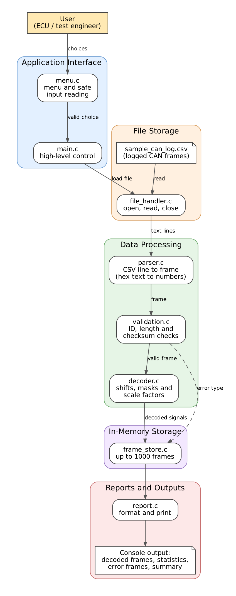

# Project Proposal

## 1. Project Information

### 1.1 Project Title

**CAN Log Decoder in C**

### 1.2 Engineering Domain

Automotive Embedded Systems (In-Vehicle Networks)

### 1.3 Student Details

| Field | Details |
|---|---|
| Student name | Nikhil Shripad Patankar |
| Roll number | 612509029 |
| Division / batch | Instrumentation and Control Engineering |
| Repository name | CAN_Log_Decoder |
| GitHub repository link | https://github.com/patankarnikhil783-svg/CAN_Log_Decoder |

### 1.4 Individual Project Declaration

I confirm that this project is my individual work. I understand the design,
source code, unit tests, Makefile and documentation included in this
repository, and I am prepared to explain or modify any part during evaluation.

Student acknowledgement: Nikhil Shripad Patankar, 08/11/2026

## 2. Engineering Scenario and Problem Definition

### 2.1 Scenario Description

**Where it occurs.** The scenario takes place in an ECU development and
vehicle test laboratory. While a vehicle or an ECU test bench is running, a
logger records the messages sent on the CAN bus into a log file.

**Who is involved.** ECU software engineers, who write the software that sends
and reads CAN messages, and test and validation engineers, who review the
recorded traffic to check that the messages are correct.

**Current working method.** The log file contains each frame as a time stamp,
an identifier and data bytes written in hexadecimal. Engineers open it in a
text editor or spreadsheet and decode the bytes by hand. For example, two
bytes must be combined into one number and then multiplied by a scale factor
to obtain the engine speed.

**Information that must be managed.** For each frame: the time stamp, the
identifier, the data length, the eight data bytes and a checksum byte. From
these the following are derived: the validity of the frame, the signals it
carries (such as engine speed, temperature and vehicle speed) and statistics
for each identifier.

**Problems with the current method.**
- Manual decoding is slow and a single wrong shift or scale factor gives a
  wrong value.
- Corrupted frames, wrong data lengths and unknown identifiers are easily
  overlooked in a long log.
- Different people may decode the same signal differently.
- There is no summary of how many frames were received, how many were faulty
  and how each signal varied.

### 2.2 Problem Statement

In an ECU development and vehicle test laboratory, software and validation
engineers need to interpret recorded CAN frames. They currently decode the
hexadecimal data by hand in text editors and spreadsheets, which results in
slow work, decoding mistakes, undetected corrupted frames and no consistent
summary of the traffic. The proposed software will parse every logged frame,
validate its identifier, length and checksum, decode the signals it carries
and report errors and statistics, so that engineers can inspect CAN traffic
quickly and consistently.

### 2.3 Proposed Solution

The CAN Log Decoder is a console application written in C. It reads a log of
recorded CAN frames and converts the raw data bytes into meaningful signals.
It is a software tool only and does not connect to any CAN hardware.

The application will:
- load a CSV log file of CAN frames;
- parse each line and convert the hexadecimal text into numbers, rejecting
  malformed lines with the line number and the reason;
- validate each frame: known identifier, data length of 8 bytes and a correct
  checksum (the XOR of bytes 0 to 6 must equal byte 7);
- decode the signals of three messages (engine data, vehicle speed and battery
  status) using bit shifts, masks and scale factors;
- keep up to 1000 processed frames in memory;
- provide a menu so the user can load a file, decode it, view statistics for
  each identifier, view the frames of one identifier, view the error frames and
  decode a single frame entered by hand;
- display the decoded values and a summary report of the errors found.

### 2.4 Target Users

| User | Responsibility | How they use the application |
|---|---|---|
| ECU software engineer | Develops software that sends and receives CAN messages | Decodes recorded traffic to check that the transmitted signals have the expected values |
| Test and validation engineer | Reviews recorded vehicle or bench data | Loads a log, finds corrupted or unknown frames and reviews statistics for each message |
| Student or evaluator (secondary) | Learns from or assesses the project | Builds, runs and tests the application to see the design in action |

## 3. Project Scope

### 3.1 In-Scope Features

1. Load a CSV log file of CAN frames.
2. Parse each line, converting the hexadecimal text into numbers, and reject
   malformed lines with the line number and the reason.
3. Validate each frame: known identifier, data length of 8 bytes and a correct
   checksum.
4. Decode the signals of three messages (engine data, vehicle speed and
   battery status) using bit shifts, masks and scale factors.
5. Store up to 1000 processed frames in memory.
6. Provide a console menu to load a file, decode it, show statistics for each
   identifier, show the frames of one identifier, show the error frames and
   decode a single frame entered by the user.
7. Validate all user input, including menu choices, file names and the bytes of
   a frame entered by hand.
8. Display the decoded values and a summary report of the frames received and
   the errors found.

### 3.2 Out-of-Scope Features

1. Any CAN hardware, adapter or live capture of CAN traffic.
2. Transmitting CAN frames.
3. Lower-level CAN mechanisms such as the hardware CRC, bit stuffing,
   arbitration and acknowledgement.
4. Reading DBC files. The signal layout is fixed in the program.
5. Extended 29-bit identifiers, remote frames and CAN FD.
6. Big-endian and signed signals.
7. More than three message types.
8. A graphical user interface or plotting of signals.

### 3.3 Assumptions

1. The log file is a plain-text CSV file with a header line.
2. Each data line contains a time stamp in milliseconds, an identifier written
   in hexadecimal, a data length and eight data bytes written as two
   hexadecimal digits each.
3. Time stamps in the file are in increasing order.
4. Identifiers are 11-bit values. A frame with a data length other than 8 is
   treated as an error.
5. Signals are unsigned and little-endian (the lower byte comes first).
6. The checksum rule is defined for this project: byte 7 must equal the XOR of
   bytes 0 to 6.
7. The program is used on a Linux system with gcc, make and Google Test
   installed.

### 3.4 Constraints

1. The project is an individual project with limited time.
2. The application is written in C (C99) and built with a Makefile.
3. The user interface is a command-line (console) menu.
4. Storage is file-based, with no database.
5. At most 1000 frames are held in memory, using fixed-size arrays and no
   dynamic memory allocation.
6. The signal layout is limited to three fixed messages.
7. Unit tests are written with Google Test.

## 4. Requirements

### 4.1 Functional Requirements

| ID | Functional Requirement | Priority | Verification Method |
|---|---|---|---|
| FR-01 | The system shall load CAN frames from a CSV log file and report a clear error if the file is missing, unreadable or has no header line. | High | Test / Demonstration |
| FR-02 | The system shall parse each data line into a frame containing a time stamp, an identifier, a data length and eight data bytes, converting the hexadecimal text into numbers. | High | Unit test |
| FR-03 | The system shall reject a malformed line, with the line number and the reason, if it has the wrong number of fields or contains a value that is not valid hexadecimal or is out of range. | High | Unit test / Negative test |
| FR-04 | The system shall check each identifier against the list of known identifiers and count a frame with an unknown identifier as an error. | High | Unit test |
| FR-05 | The system shall check that the data length of each frame is 8 and count any other length as an error. | High | Unit test |
| FR-06 | The system shall check that byte 7 equals the XOR of bytes 0 to 6 and count a mismatch as a checksum error. | High | Unit test |
| FR-07 | The system shall decode the engine data message (0x100): engine speed, coolant temperature and throttle position. | High | Unit test |
| FR-08 | The system shall decode the vehicle speed message (0x200): vehicle speed, brake state and gear. | High | Unit test |
| FR-09 | The system shall decode the battery status message (0x300): battery voltage. | High | Unit test |
| FR-10 | The system shall store up to 1000 processed frames and report an error when this capacity is reached. | Medium | Test |
| FR-11 | The system shall display a main menu and perform the selected action until the user chooses to exit. | High | Demonstration |
| FR-12 | The system shall validate menu choices, file names and bytes entered by the user, and ask again after displaying a message when the input is invalid. | High | Negative test / Demonstration |
| FR-13 | The system shall display each processed frame with its decoded signals, or with the error found. | High | Demonstration |
| FR-14 | The system shall display statistics for each identifier: frames received, valid frames and error frames. | Medium | Demonstration |
| FR-15 | The system shall display the stored frames of one identifier chosen by the user. | Medium | Demonstration |
| FR-16 | The system shall display the stored error frames together with the type of each error. | Medium | Demonstration |
| FR-17 | The system shall validate and decode a single frame entered by the user and display the result. | Medium | Demonstration |
| FR-18 | The system shall display a summary report with the number of lines read, frames decoded, lines rejected, checksum errors, length errors and unknown identifiers. | High | Demonstration |

### 4.2 Non-Functional Requirements

| ID | Non-Functional Requirement | Verification Method |
|---|---|---|
| NFR-01 | The source code shall compile without warnings. | Build output |
| NFR-02 | The project shall use a modular multi-file structure. | Code review |
| NFR-03 | The application shall handle invalid input without crashing. | Negative testing |
| NFR-04 | Important functions shall be tested using gTest. | Unit-test output |
| NFR-05 | The project shall build using a Makefile. | Build demonstration |
| NFR-06 | The project shall be maintained in a GitHub repository. | Repository review |
| NFR-07 | The identifiers, signal positions, scale factors and offsets shall be defined in one place so they can be changed without editing the decoding logic. | Code review |
| NFR-08 | Parsing, validation and decoding functions shall not perform file or console input and output, so that they can be unit tested. | Code review |
| NFR-09 | The program shall use fixed-size arrays and shall not use dynamic memory allocation. | Code review |
| NFR-10 | All bit shifts and masks shall be performed on unsigned types. | Code review |
| NFR-11 | User input shall be read with bounded buffers and safe functions only. | Code review |
| NFR-12 | The code shall follow one consistent naming style and comment standard. | Code review |
| NFR-13 | The program shall process 1000 frames in less than one second. | Demonstration |

### 4.3 Requirement Traceability

This table links each requirement to its module, function and test. It will be
completed after the detailed design and the unit-test plan are prepared.

## 5. High-Level Architecture

### 5.1 Architecture Description

The CAN Log Decoder is a layered console application written in C. Each layer
has one responsibility and communicates only through functions declared in
header files.

- **Application interface.** `menu.c` displays the menu and reads the user's
  input safely. `main.c` contains only the high-level control loop: it asks
  `menu.c` for a validated choice and calls the module that performs it.
- **File storage.** `file_handler.c` is the only module that opens, reads and
  closes files. It reads the CSV log file one line at a time.
- **Data processing.** `parser.c` converts a CSV text line into a frame,
  turning the hexadecimal text into numbers. `validation.c` checks the
  identifier, the data length and the checksum. `decoder.c` extracts the
  signals from the data bytes using shifts, masks and scale factors. These
  modules do not read files or print, so they can be unit tested.
- **In-memory storage.** `frame_store.c` keeps up to 1000 processed frames in
  a fixed-size array, so that the user can review them by identifier or by
  error type.
- **Reports and outputs.** `report.c` formats and prints the decoded frames,
  the statistics, the error frames and the summary to the console.

Shared data types and constants are declared in one header file, `types.h`.
The table of known identifiers and signals is kept in one place so that it can
be changed without editing the decoding logic.

### 5.2 Architecture Diagram

### 5.3 High-Level Workflow

1. The user starts the program.
2. The program displays the main menu.
3. The user enters a choice. If the choice is invalid, the program shows a
   message and displays the menu again.
4. **Load log file:** the user enters a file name. The program opens the file
   and reports an error if it cannot be read.
5. **Decode:** for each data line, the program parses it, checks the
   identifier, the data length and the checksum, decodes the signals of valid
   frames and stores the result. Malformed lines are rejected with their line
   number and the reason, and processing continues.
6. **Show statistics:** the program shows, for each identifier, the frames
   received, the valid frames and the error frames.
7. **Show frames of one identifier:** the user enters an identifier and the
   program lists the stored frames with that identifier.
8. **Show error frames:** the program lists the stored frames that failed a
   check, with the type of each error.
9. **Decode a single frame:** the user enters the identifier and the data bytes
   of one frame, and the program validates and decodes it.
10. After each action, the program returns to the menu.
11. **Exit:** the program closes any open file and ends.